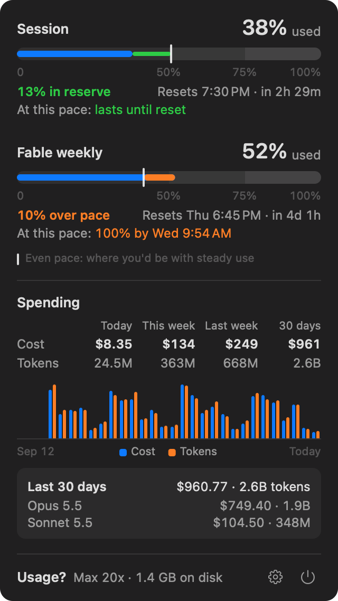
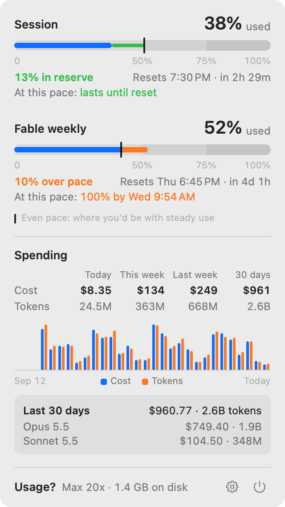

<p align="center"></p>

<h1 align="center">Usage?</h1>

<p align="center"><b>How much Claude have I used?</b><br>
A tiny, native macOS menu bar app for your Claude Code limits and spending.</p>

<p align="center">
  
  &nbsp;
  
</p>

<p align="center">
  
  &nbsp;&nbsp;
  
</p>

<p align="center"><sub>Screenshots use made-up demo data.</sub></p>

## What you see

- **Your limits as meters.** Session and weekly limits (including model-specific ones such as *Fable weekly*) show how much is used, with marks at 50%, 75% and 100%.
- **Pace on the meter itself.** A thin marker shows the *even pace*: where you'd be with steady use. The gap between it and your usage is your reserve (green) or how far over pace you are (orange).
- **Plain answers.** *12% in reserve*, *At this pace: lasts until reset*, or *100% by Wed 9:14 AM*. Resets are shown as clock times, *Resets 6:15 PM · in 2h 29m*.
- **Spending.** Cost and tokens for Today, This week, Last week and the last 30 days, estimated at API prices from your local Claude Code logs.
- **30 days at a glance.** Daily cost and token bars, with your top two models over those 30 days. Hover a day to see that day's totals and top two models instead.
- **Notifications at your percentages.** Type `50,75` under Settings › Notify at, and Usage? tells you when a limit reaches each value, once per reset period.
- **The essentials, nothing else.** Your plan, the disk space Claude Code uses, Settings and Quit, all in one footer.
- **In the menu bar.** Two tiny meters (session and weekly) and how much of your session you've used.

## Install

You need a Mac with Apple silicon running macOS 27 or later, the Xcode Command Line Tools (`xcode-select --install`), and to have signed in to Claude Code at least once.

```sh
git clone https://github.com/bhaskar0210s/UsageQ.git
cd UsageQ
make install
```

`make install` builds the app and installs it as `/Applications/UsageQ.app`, which Finder shows as **Usage?**. It also links the `usageq` command into `~/.local/bin` and starts the app. On first launch the app adds itself to Login Items; turn that off under ⚙︎ → Launch at login. `make uninstall` removes everything again.

> **Why UsageQ?** The app is called **Usage?**, but a question mark can't go in repository names or terminal commands, so those use **UsageQ** / `usageq`.

## Using it

- **Click the meters icon** to open the card. Every click refreshes the numbers.
- **Hover the bars** to inspect any of the last 30 days. Move the pointer down and the day stays selected while you read it. Move away and the box goes back to the whole 30 days.
- **⚙︎ Settings** open right inside the card: refresh every 5 minutes (the default), 15 minutes or 1 hour, or Off; Notify at; launch at login; and show Claude Code's data in Finder. **Done** (or ⚙︎ again) takes you back. With refresh Off, the numbers update only when you open the menu (and once at launch), and so do the Notify at checks.
- **Notify at** takes whole percentages separated by commas, like `50,75` or `50,75,90`; leave it empty for no notifications. Each limit (the session and each weekly limit) notifies once per value per reset period, checked whenever the numbers refresh. macOS asks for permission the first time. To keep the notifications on screen until you close them, choose **Persistent** in System Settings › Notifications › Usage?.
- **⏻ Quit**, or press ⌘Q while the card is open.
- When the numbers aren't fresh, for example offline, a short note at the top says so and shows how old they are.

## For scripts and agents

```sh
usageq          # readable summary
usageq --json   # limits, pace, spending (30 daily points, top models per day and overall), disk use
```

```text
Claude · you@example.com · Max 20x · updated just now
Session        38% used  resets in 2h 29m   12% in reserve · lasts until reset
Fable weekly   52% used  resets in 4d 1h    10% over pace · 100% in 2d 17h
Today          $8.35       24.5M tokens
This week      $134.12     363M tokens
Last week      $249.40     668M tokens
Last 30 days   $961.07     2.6B tokens
  Opus 5.5     $749.40     1.9B tokens
  Sonnet 5.5   $104.50     348M tokens
Storage        1.4 GB
```

## How it works

- **Limits** come from the endpoint Claude Code uses for `/usage` (`api.anthropic.com/api/oauth/usage`). The app uses Claude Code's own login token. It reads the token from Claude Code's Keychain item through `/usr/bin/security`, which that item already trusts, so there's no prompt. Each request runs in a short-lived `/usr/bin/curl` process with the token passed on stdin. Nothing is stored or sent anywhere else.
- **Pace** compares your usage with steady use since the window opened. If your current rate would reach 100% before the reset, you see when.
- **Spending** is read from `~/.claude/projects/**/*.jsonl`. Each API response counts once, even though Claude Code logs it repeatedly. Prices follow Anthropic's API list prices, including cache writes (5-minute vs 1-hour), long-context tiers and fast mode. These are API-equivalent estimates; a subscription doesn't bill this way.
- The usage endpoint rate-limits bursts. The app calls it at most every 30 seconds and backs off when told to; the local log scan runs on every click.
- **Notifications** are posted by the app itself after a refresh, through macOS's own notification system. Nothing is sent anywhere else.

## Small on purpose

About 15 MB of memory when idle and about 19 MB after the card has been opened and used, where it stays. An empty AppKit menu bar app takes 11 MB on the same Mac. Measured with `footprint` on macOS 27.0.1: idle 10 seconds after launch, and after 20 rounds of opening the card, hovering every bar and opening Settings.

- The data layer (`src/core`) is plain C++20. The app (`src/app/main.mm`) is a thin AppKit shell, and the card is a single custom-drawn view using SF Pro, SF Symbols and system colors.
- Keychain and network access run in short-lived helper processes, so no networking stack stays loaded.
- The log scanner reads only newly appended lines after the first pass. That first pass finds usage records with NEON vector instructions, so 30 days of logs (about 1 GB here) take about 0.2 s. Its buffers live on their own memory pages and are handed back to the system after every pass.
- Routine refreshes run at background priority, so they stay on the efficiency cores. Opening the card refreshes at full speed.
- The card is drawn on the CPU into a plain image that macOS shows as it is. Drawing it the usual way would load Metal into the app and keep megabytes of GPU buffers for its lifetime. While the card is open, the clock-driven parts update once a minute.

```sh
make leakcheck   # Apple's `leaks` on the CLI, then on the app through 100 cycles of refresh, hover and Settings
make test        # unit tests for the core, with AddressSanitizer and UBSan
make clicktest   # opens the real menu on demo data and uses it: Settings, typing in Notify at, Done, hover
```

The app's own code shows zero leaks. `leaks` does list 26 KB from Apple's AppIntents framework, which an empty AppKit app reports identically.

## Develop

```sh
make            # app + CLI in build/
make dev        # debuggable build with test hooks:
                #   --soak N                         refresh, hover and Settings cycles, printing memory
                #   --click-test [out.png|quit|cmdq] click through the open menu, checking each step
                #   --notify-test                    send one test notification and report what macOS says
                #   --render out.png --demo          draw the card with demo data (--dark, --day N, --stale, --settings)
                #   --render-bar out.png [--dark]    draw the menu bar item
```

```
src/core/   C++ data layer: limits API, credentials, log scanner, pricing, pace, storage
src/cli/    usageq command-line tool
src/app/    AppKit menu bar app
```

## Acknowledgements

Thanks to [CodexBar](https://github.com/steipete/CodexBar) (MIT), whose open-source Claude provider documents the usage endpoint and credential handling. Usage? is an independent, Claude-only app with its own design and code.

## License

MIT. Usage? is an independent project, not affiliated with or endorsed by Anthropic. Claude is a trademark of Anthropic.
